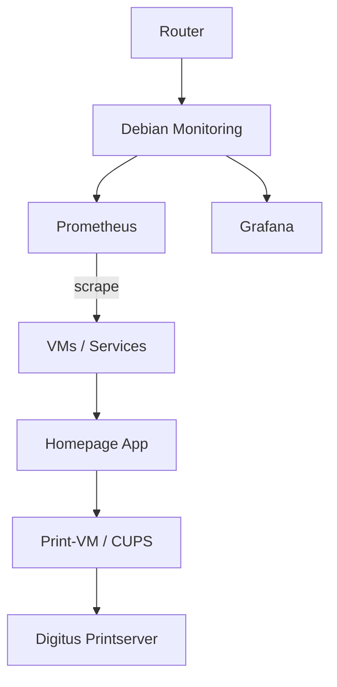

# Debian — Kategorie Übersicht

Diese Seite fasst die Debian-bezogenen Themen des Homelabs zusammen.

---

## Zweck

Debian-Hosts dienen als zentrale Betriebsbasis für:

- Monitoring- und Log-Aggregation
- Verwaltung und Systemdienste
- zentrale Netzwerkanbindung
- Container-/Service-Hosts
- lokale Helper- und Automation-Workflows

---

## Typische Bestandteile

- Monitoring-Server mit Prometheus, Grafana und Log-Tools
- Debian-basierte VM oder Host für Dienstverwaltung
- Homepage-Dashboard und interne Web-Services
- Netzwerk- und Tailscale-Integration
- zentrale Backup-, Reparatur- und Wartungshandlungen

---

## Wichtige Dateien

- `Debian-Monitoring/README.md` – Monitoring-Server und Metriken
- `Debian/homepage.md` – Homepage- und Dashboard-Überblick
- `Netzwerk/README.md` – Netzwerk- und Sicherheitskonzepte

---

## Zu beachten

- Debian-Hosts sind oft die wichtigste Betriebsebene des Homelab.
- Änderungen an Systemservices, Firewall und Netzwerk müssen mit Prüfung erfolgen.
- Priorität hat Stabilität, Wiederherstellbarkeit und fehlersichere Administration.

---

## Beispiel-Architektur

