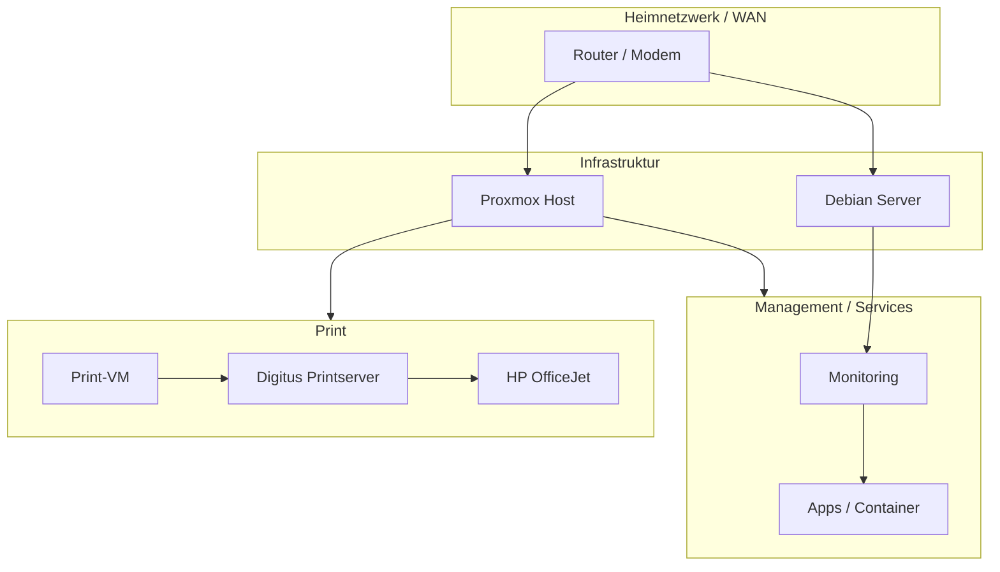
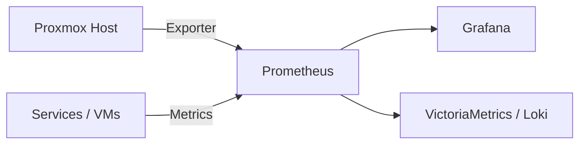
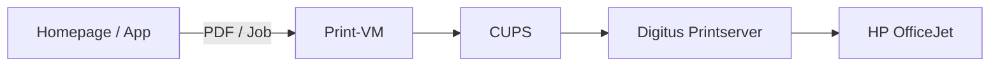

# 🌐 Netzwerk-Topologie

Detaillierte Übersicht der logischen Netzwerk-Architektur, Zonen und Datenflüsse. Diese Datei ist bewusst generisch gehalten, damit sie keine internen IP-Adressen oder produktiven Geräte-Details offenlegt.

---

## Überblick

---

## Netzwerk-Segmentierung

### Management & Monitoring

- Zweck: Hosts, Monitoring, Administration, Backups
- Regelfocus: Zugriffe streng kontrollieren

### Services

- Zweck: produktive Container, Webdienste, Media-Services
- Regelfocus: nur notwendige Verbindungen zulassen

### Print

- Zweck: CUPS, Digitus, Drucker
- Regelfocus: isoliert halten und nur gezielt zugänglich machen

### Guest / IoT

- Zweck: untrusted Geräte
- Regelfocus: streng begrenzter Zugriff

---

## Datenflüsse

### Monitoring-Flow

### Print-Flow

---

## Bridge- und Firewall-Empfehlungen

- Proxmox-Bridges nur mit klarer Zielsetzung konfigurieren
- Routing nur dort, wo es wirklich benötigt wird
- Firewall-Regeln nach Zonen und Kommunikationsmustern festlegen
- keine vermeintlich „sicheren” Default-Regeln ohne Prüfung übernehmen

---

## Wichtige Hinweise

- Die tatsächliche Topologie kann je nach Hausnetzwerk und eingebauter Hardware variieren.
- Routing, VLANs und Dienstzugriffe müssen lokal validiert werden.
- Produktive Netzwerke niemals ohne Dokumentation und Risikoanalyse ändern.
