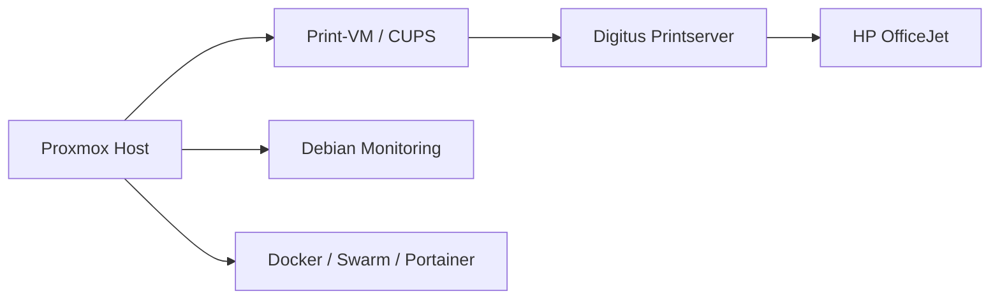

# Proxmox — Kategorie Übersicht

Diese Seite fasst die Proxmox-bezogenen Themen des Homelabs zusammen.

---

## Kurzbeschreibung

Proxmox ist die zentrale Hypervisor- und Virtualisierungsbasis für das Homelab. Es verwaltet VMs, LXC Container, Storage, Netzwerke und wichtige Service-Umgebungen.

---

## Wichtige Themen

- Proxmox-Host und Base-Umgebungen
- VM- und Container-Management
- Storage- und Backup-Strategie
- Print- und Drucker-Integrationen
- Monitoring- und Verwaltungsdienste
- Sicherheits- und Netzwerkanforderungen

---

## Wichtige Dateien

- `Proxmox/README.md` — allgemeine Proxmox-Dokumentation
- `Proxmox/printer-vm.md` — Einrichtung einer Debian-Print-VM
- `Proxmox/hp-officejet-4658.md` — Drucker- und Printserver-Details
- `Proxmox/print-worker.service` — Systemd-Service für Print-Worker

---

## Architekturüberblick

---

## Betriebsregeln

- Interne Systemdatenträger und ZFS-Pools sind geschützt
- Änderungen an Netzwerken und Bridges nur nach gründlicher Prüfung
- Backups vor größeren Änderungen aktivieren
- Druck- und Print-Workflows separat dokumentieren und absichern
