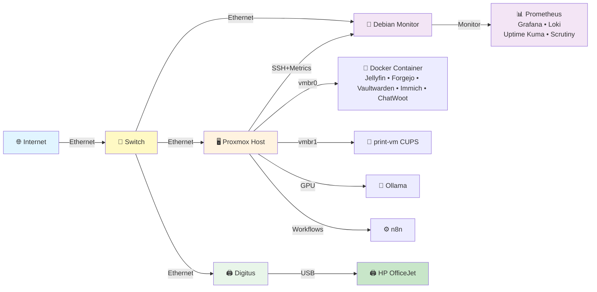

# 🏠 Hoinkkoma Homelab

**Letzte Aktualisierung:** 2026-09-02 | **Maintainer:** [@Hoinkkoma](https://github.com/Hoinkkoma)

Moin Moin Leude das ist mein homlap projekt die repro ist ne kleine dokumatirung des projektes in der alles kurtz zusammen gefast ist.

---

## 🚀 Quick Start

| 🎯 Bereich | 📖 Link | 🔧 Kurzbeschreibung |
|:---:|---|---|
| **🐧 Debian Server** | [`Debian-Monitoring/`](./Debian-Monitoring/) | Monitoring-Zentrale (Prometheus, Grafana, Loki, Cockpit) |
| **🖥️ Proxmox VE** | [`Proxmox/`](./Proxmox/) | Virtualisierungs-Host (VMs, Container, OpenCL, Ollama, n8n) |
| **📺 Streaming** | [`Docker/`](./Docker/) | Jellyfin, Immich, FileBrowser |
| **🤖 KI & ML** | [`Proxmox/ai-ml.md`](./Proxmox/ai-ml.md) | Ollama, OpenCL, GPU-Computing |
| **⚙️ Automation** | [`Proxmox/n8n.md`](./Proxmox/n8n.md) | n8n Workflows, Ablauf-Automation |
| **💬 Support & Comm.** | [`Docker/chatwoot-setup.md`](./Docker/chatwoot-setup.md) | ChatWoot, Kundenkommunikation |

---

## 🏗️ Infrastruktur-Übersicht



---

## 🖥️ Alle Geräte (Detaillierte Übersicht)

| Gerät | Typ | Spezifikation | Funktion | Services |
|---|---|---|---|---|
| **Proxmox ThinkCentre Tower PC** | Virtualisierungs-Host | Intel CPU, 16-32GB RAM, SSD | Zentrale Compute-Plattform | VMs, LXC Container, Docker, OpenCL, Ollama, n8n, print-vm |
| **Debian Server (Mini-PC)** | Monitoring & Verwaltung | ARM/x86, 4-8GB RAM | Zentrale Überwachung & Verwaltung | Prometheus, Grafana, Loki, Cockpit, Uptime Kuma, Scrutiny, ChatWoot |
| **Digitus Print Server** | Print-Gateway | Standalone Device | Druck-Management | CUPS Server, HP OfficeJet Verbindung, JetDirect (Port 9100) |
| **ThinkPad T490s** | Admin-Laptop | Intel i7, 16GB RAM | Administrative Aufgaben | SSH, Remote Desktop, Web-UI Zugriff |
| **HP OfficeJet 4558** | Drucker | USB + Netzwerk-fähig | Druck & Scan | Verbunden über Digitus Printserver |
| **Nothing Phone 3a** | Smartphone | ARM64 | Mobile Zugriff | VPN, Apps, Benachrichtigungen |
| **ThinkBook** | Allgemeines Laptop | Intel/AMD | Allgemeine Nutzung | Webzugriff, SSH, Entwicklung |

---

## 🎯 Features & Services

### 💻 Virtualisierung & Automatisierung
- **Proxmox VE** — Hypervisor für VMs & Container
- **n8n** — Workflow-Automation & Orchestrierung
- **Docker** — Container-Management mit Portainer

### 📊 Monitoring & Observability
- **Prometheus** — Metrik-Erfassung
- **Grafana** — Dashboards & Visualisierung
- **Loki** — Log-Aggregation
- **Uptime Kuma** — Service-Monitoring
- **Scrutiny** — S.M.A.R.T. Festplatten-Überwachung
- **Cockpit** — Webbasierte Server-Verwaltung

### 📺 Media & Storage
- **Jellyfin** — Medienserver (Filme, Serien, Musik)
- **Immich** — Foto-Management & Cloud
- **FileBrowser** — Web-Dateimanager

### 🤝 Zusammenarbeit & Sicherheit
- **Forgejo** — Self-Hosted Git-Server
- **Vaultwarden** — Passwort-Manager
- **ChatWoot** — Customer Support & Messaging

### 🤖 KI & Machine Learning
- **Ollama** — Lokaler LLM-Server (qwull-Modell)
- **OpenCL** — GPU-Computing & GPGPU

---

## 📁 Dokumentation (Kompakt & Ausführlich)

### 🐧 **Debian Server** — Monitoring & Verwaltung
```
Debian-Monitoring/README.md
├─ Prometheus Setup & Konfiguration
├─ Grafana Dashboards & Datasources
├─ Loki Log-Aggregation
├─ Uptime Kuma Service-Monitoring
├─ Scrutiny S.M.A.R.T. Überwachung
└─ Cockpit Webbasierte Verwaltung

Debian/README.md
├─ SSH & SSH-Key Setup
├─ NTP & Zeit-Synchronisierung
├─ DNS-Caching mit unbound
├─ Syslog & Log-Management
└─ Firewall & iptables Config

Debian/config/
├─ systemd Services
├─ Netzwerk-Konfiguration
├─ Firewall-Regeln
└─ Update-Strategie
```

### 🖥️ **Proxmox VE** — Virtualisierung & Automation
```
Proxmox/README.md
├─ Proxmox Installation & Setup
├─ VMs & LXC Container erstellen
├─ VM-Management & Live-Migration
├─ Storage-Konfiguration
├─ Netzwerk-Bridges (vmbr0, vmbr1)
└─ USB-Passthrough & Hardware

Proxmox/printer-vm.md
├─ print-vm LXC Container Setup
├─ CUPS Installation & Konfiguration
├─ Drucker-Verbindung & Einrichtung
├─ IPP-Protokoll Einrichtung
└─ Troubleshooting Print-Probleme

Proxmox/ai-ml.md
├─ OpenCL Setup & GPU-Erkennung
├─ Ollama Installation & Konfiguration
├─ qwull-Modell laden & verwenden
├─ GPU-Speicher Management
└─ Performance-Optimierung

Proxmox/n8n.md
├─ n8n Docker Installation
├─ Workflow-Beispiele
├─ Integration mit externen Services
├─ Fehlerbehandlung & Logging
└─ Backup & Restore

Proxmox/print-worker.service
└─ Systemd Service für Print-Automation
```

### 🐳 **Docker & Anwendungen** — Container & Services
```
Docker/README.md
├─ Docker Installation & Setup
├─ Docker-Compose für Multi-Container
├─ Portainer UI Verwaltung
├─ Volume & Netzwerk Management
└─ Best Practices & Security

Docker/chatwoot-setup.md
├─ ChatWoot Installation
├─ Datenbank-Setup (PostgreSQL)
├─ Kanal-Konfiguration
├─ Webhooks & Integrationen
└─ Email-Setup & Notifications

docs/apps.md
├─ Jellyfin Medienserver Setup
├─ Immich Foto-Management
├─ FileBrowser Dateimanager
├─ Forgejo Git-Server
├─ Vaultwarden Passwort-Manager
└─ Weitere Container-Apps
```

### 🌐 **Netzwerk** — Architektur & Konfiguration
```
Netzwerk/README.md
├─ Netzwerk-Architektur & Topologie
├─ IP-Adressierung & Subnets
├─ VPN-Setup & Konfiguration
├─ Firewall-Regeln
└─ Netzwerk-Troubleshooting

Netzwerk/network-diagram.md
├─ Detaillierte Topologie
├─ VLAN-Konfiguration (wenn vorhanden)
├─ Routing-Tabellen
└─ Redundanz & Failover

Netzwerk/printserver-digitus.md
├─ Digitus Printserver Setup
├─ Netzwerk-Verbindung
├─ CUPS-Integration
└─ HP OfficeJet Konfiguration
```

### 🔧 **Wartung & Support** — Operationen & Troubleshooting
```
Wartung/
├─ Tägliche Checks & Checklisten
├─ Wöchentliche Wartungsaufgaben
├─ Monatliche Sicherheits-Reviews
├─ Backup & Disaster Recovery
└─ Update-Strategie & Patches

Fehlerbehebung/
├─ Häufige Fehler & Lösungen
├─ Logging & Debugging
├─ Performance-Issues
├─ Netzwerk-Probleme
├─ Service-Recovery
└─ Emergency Procedures
```

### 📦 **Ressourcen** — Assets & Meta
```
assets/
├─ Grafiken & Diagramme
├─ Icons & Logos
└─ Schablonen

CHANGELOG.md
└─ Versionshistorie & Updates

CONTRIBUTING.md
├─ Mitarbeiter-Richtlinien
├─ Code-Style
└─ PR-Prozess

LICENSE
└─ Apache License 2.0
```

---

## ⚡ Homepage-Struktur (6 Kacheln)

| Kachel | Inhalt |
|:---:|---|
| 🐧 **Debian Server** | Monitoring & Verwaltung, VPN, Überwachung |
| 🖥️ **Proxmox** | Virtualisierung, VMs, Container, Digitus |
| 📺 **Streaming** | Jellyfin, Medien, Video/Audio-Management |
| 🤖 **KI & ML** | Ollama, OpenCL, GPU-Compute |
| 💬 **Support & Comm.** | ChatWoot, Vaultwarden, Forgejo, n8n |
| 💪 **Unterstützung** | Docs, Troubleshooting, Wiki, Support |

---

## ✅ Tägliche Checks

```bash
□ Alle Services laufen?          systemctl status
□ Kritische Alerts?              Grafana Dashboard
□ Disk-Space OK?                 df -h oder Scrutiny
□ Netzwerk stabil?               ping <services>
□ Druck verfügbar?               CUPS Dashboard
□ Ollama läuft?                  curl http://proxmox:11434/api/tags
□ n8n Workflows OK?              n8n Dashboard prüfen
□ ChatWoot verfügbar?            http://debian:3000
```

---

## ⚠️ Häufige Probleme

| Problem | Lösung |
|---|---|
| **Druck geht nicht** | Digitus mit Switch neu verbinden |
| **Prometheus weg** | `systemctl restart prometheus` auf Debian |
| **Docker voll** | `docker system prune -a` |
| **Ollama antwortet nicht** | Siehe [`Proxmox/ai-ml.md`](./Proxmox/ai-ml.md) |
| **n8n nicht erreichbar** | Container Status prüfen: `docker ps` |
| **ChatWoot down** | Docker neu starten: `docker-compose restart chatwoot` |
| **Netzwerk langsam** | Siehe [`Netzwerk/README.md`](./Netzwerk/README.md) |

**Ausführlich:** [`Fehlerbehebung/`](./Fehlerbehebung/)

---

## 🚀 Erste Schritte

1. **Infrastruktur verbinden**
   - Switch mit Internet, Proxmox, Debian verbinden
   - Digitus mit Switch & HP OfficeJet verbinden

2. **Netzwerk konfigurieren**
   - Proxmox: `vmbr0`, `vmbr1` setup
   - Debian: Statische IP konfigurieren

3. **Services starten**
   - Debian: Prometheus, Grafana, Loki, Cockpit
   - Proxmox: Docker Container, n8n, Ollama

4. **Monitoring aktivieren**
   - Grafana Dashboard öffnen
   - Prometheus Jobs konfigurieren

5. **Workflows & Automation**
   - n8n installieren & erste Workflows
   - ChatWoot Kanäle setup

**Anleitung:** Siehe jeweilige `README.md` in `Debian-Monitoring/`, `Proxmox/`, `Docker/`

---

## 🤝 Beitragen

Fehler gefunden? Ideen? → [`CONTRIBUTING.md`](./CONTRIBUTING.md)

---

**Status:** ✅ Aktiv | **Letztes Update:** 2026-09-02
