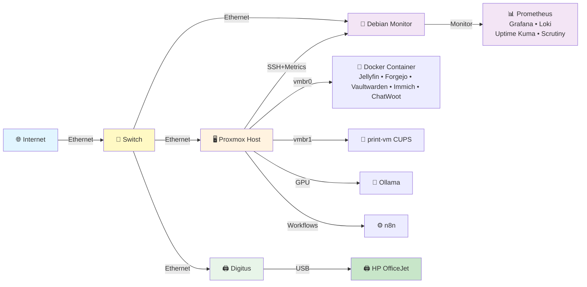

# 🏠 Hoinkkoma Homelab

**Letzte Aktualisierung:** 2026-09-02 | **Maintainer:** [@Hoinkkoma](https://github.com/Hoinkkoma)

Moin Moin Leude das ist mein homlap projekt die repro ist ne kleine dokumatirung des projektes in der alles kurtz zusammen gefast ist.

---

## 🚀 Quick Start

| 🎯 Bereich | 📖 Link | 🔧 Kurzbeschreibung |
|:---:|---|---|
| **🐧 Debian Server** | [`Debian-Monitoring/`](./Debian-Monitoring/) | Monitoring-Zentrale (Prometheus, Grafana, Loki, Cockpit) |
| **🖥️ Proxmox VE** | [`Proxmox/`](./Proxmox/) | Virtualisierungs-Host (VMs, Container, OpenCL, Ollama, n8n) |
| **📺 Streaming** | [`Docker/`](./Docker/) | Jellyfin, Immich, FileBrowser |
| **🤖 KI & ML** | [`Proxmox/ai-ml.md`](./Proxmox/ai-ml.md) | Ollama, OpenCL, GPU-Computing |
| **⚙️ Automation** | [`Proxmox/n8n.md`](./Proxmox/n8n.md) | n8n Workflows, Ablauf-Automation |
| **💬 Support** | [`Docker/chatwoot-setup.md`](./Docker/chatwoot-setup.md) | ChatWoot, Kundenkommunikation |

---

## 🏗️ Infrastruktur-Übersicht



---

## 📋 Alle Geräte

| Gerät | Typ | Beschreibung |
|---|---|---|
| Proxmox ThinkCentre Tower PC | Virtualisierungs-Host | VMs, LXC, Docker, OpenCL, Ollama, n8n |
| Debian Server (Mini-PC) | Monitoring & Verwaltung | Prometheus, Grafana, Loki, Cockpit, ChatWoot |
| Digitus Print Server | Print-Gateway | CUPS, HP OfficeJet |
| ThinkPad T490s | Admin-Laptop | SSH, Verwaltung |
| Nothing Phone 3a | Smartphone | Mobilgerät |

---

## 🎯 Features & Services

### 💻 Virtualisierung & Automatisierung
- **Proxmox VE** — Hypervisor für VMs & Container
- **n8n** — Workflow-Automation & Orchestrierung
- **Docker** — Container-Management mit Portainer

### 📊 Monitoring & Observability
- **Prometheus** — Metrik-Erfassung
- **Grafana** — Dashboards & Visualisierung
- **Loki** — Log-Aggregation
- **Uptime Kuma** — Service-Monitoring
- **Scrutiny** — S.M.A.R.T. Festplatten-Überwachung
- **Cockpit** — Webbasierte Server-Verwaltung

### 📺 Media & Storage
- **Jellyfin** — Medienserver (Filme, Serien, Musik)
- **Immich** — Foto-Management & Cloud
- **FileBrowser** — Web-Dateimanager

### 🤝 Zusammenarbeit & Sicherheit
- **Forgejo** — Self-Hosted Git-Server
- **Vaultwarden** — Passwort-Manager
- **ChatWoot** — Customer Support & Messaging

### 🤖 KI & Machine Learning
- **Ollama** — Lokaler LLM-Server (qwull-Modell)
- **OpenCL** — GPU-Computing & GPGPU

---

## 📁 Dokumentation

### 🐧 **Debian Server**
```
Debian-Monitoring/README.md  — Monitoring Setup
Debian/README.md             — Services & Config
Debian/config/               — Systemd, Netzwerk, Firewall
```

### 🖥️ **Proxmox VE**
```
Proxmox/README.md            — VM & Container Management
Proxmox/printer-vm.md        — Print-Gateway Setup
Proxmox/ai-ml.md             — Ollama & OpenCL
Proxmox/n8n.md               — n8n Workflow-Automatisierung
```

### 🐳 **Docker & Anwendungen**
```
Docker/README.md             — Docker & Portainer
Docker/chatwoot-setup.md     — ChatWoot Installation
docs/apps.md                 — Alle Services im Überblick
```

### 🌐 **Netzwerk**
```
Netzwerk/README.md           — Netzwerk-Architektur
Netzwerk/network-diagram.md  — Topologie
Netzwerk/printserver-digitus.md  — Printserver-Config
```

### 🔧 **Wartung & Support**
```
Wartung/                     — Regelmäßige Aufgaben
Fehlerbehebung/              — Troubleshooting
```

---

## ⚡ Homepage-Struktur (6 Kacheln)

| Kachel | Inhalt |
|:---:|---|
| 🐧 **Debian Server** | Monitoring & Verwaltung, VPN, Überwachung |
| 🖥️ **Proxmox** | Virtualisierung, VMs, Container, Digitus |
| 📺 **Streaming** | Jellyfin, Medien, Video/Audio-Management |
| 🤖 **KI & ML** | Ollama, OpenCL, GPU-Compute |
| 💬 **Support & Comm.** | ChatWoot, Vaultwarden, Forgejo, n8n |
| 💪 **Unterstützung** | Docs, Troubleshooting, Wiki, Support |

---

## 🔗 Wichtige Ports & URLs

| Service | Port | URL | Host |
|---|---:|---|---|
| **Grafana** | 3002 | `http://debian:3002` | Debian |
| **Prometheus** | 9091 | `http://debian:9091` | Debian |
| **Loki** | 3100 | `http://debian:3100` | Debian |
| **Cockpit** | 9090 | `https://debian:9090` | Debian |
| **Ollama API** | 11434 | `http://proxmox:11434` | Proxmox |
| **n8n** | 5678 | `http://proxmox:5678` | Docker |
| **ChatWoot** | 3000 | `http://docker:3000` | Docker |
| **Jellyfin** | 8096 | `http://docker:8096` | Docker |
| **CUPS** | 631 | `http://print-vm:631` | print-vm |
| **SSH** | 22 | `ssh user@host` | Alle |

---

## ✅ Tägliche Checks

```bash
□ Alle Services laufen?          systemctl status
□ Kritische Alerts?              Grafana Dashboard
□ Disk-Space OK?                 df -h oder Scrutiny
□ Netzwerk stabil?               ping <services>
□ Druck verfügbar?               CUPS Dashboard
□ Ollama läuft?                  curl http://proxmox:11434/api/tags
□ n8n Workflows OK?              n8n Dashboard prüfen
□ ChatWoot verfügbar?            http://docker:3000
```

---

## ⚠️ Häufige Probleme

| Problem | Lösung |
|---|---|
| **Druck geht nicht** | Digitus mit Switch neu verbinden |
| **Prometheus weg** | `systemctl restart prometheus` auf Debian |
| **Docker voll** | `docker system prune -a` |
| **Ollama antwortet nicht** | Siehe [`Proxmox/ai-ml.md`](./Proxmox/ai-ml.md) |
| **n8n nicht erreichbar** | Container Status prüfen: `docker ps` |
| **ChatWoot down** | Docker neu starten: `docker-compose restart chatwoot` |
| **Netzwerk langsam** | Siehe [`Netzwerk/README.md`](./Netzwerk/README.md) |

**Ausführlich:** [`Fehlerbehebung/`](./Fehlerbehebung/)

---

## 🚀 Erste Schritte

1. **Infrastruktur verbinden**
   - Switch mit Internet, Proxmox, Debian verbinden
   - Digitus mit Switch & HP OfficeJet verbinden

2. **Netzwerk konfigurieren**
   - Proxmox: `vmbr0`, `vmbr1` setup
   - Debian: Statische IP konfigurieren

3. **Services starten**
   - Debian: Prometheus, Grafana, Loki, Cockpit
   - Proxmox: Docker Container, n8n, Ollama

4. **Monitoring aktivieren**
   - Grafana Dashboard öffnen
   - Prometheus Jobs konfigurieren

5. **Workflows & Automation**
   - n8n installieren & erste Workflows
   - ChatWoot Kanäle setup

**Anleitung:** Siehe jeweilige `README.md` in `Debian-Monitoring/`, `Proxmox/`, `Docker/`

---

## 📦 Ressourcen

| Bereich | Dateien |
|---|---|
| **Grafiken** | `assets/` |
| **Versionshistorie** | `CHANGELOG.md` |
| **Mitarbeit** | `CONTRIBUTING.md` |
| **Lizenz** | `LICENSE` (Apache 2.0) |

---

## 🤝 Beitragen

Fehler gefunden? Ideen? → [`CONTRIBUTING.md`](./CONTRIBUTING.md)

---

**Status:** ✅ Aktiv | **Letztes Update:** 2026-09-02
